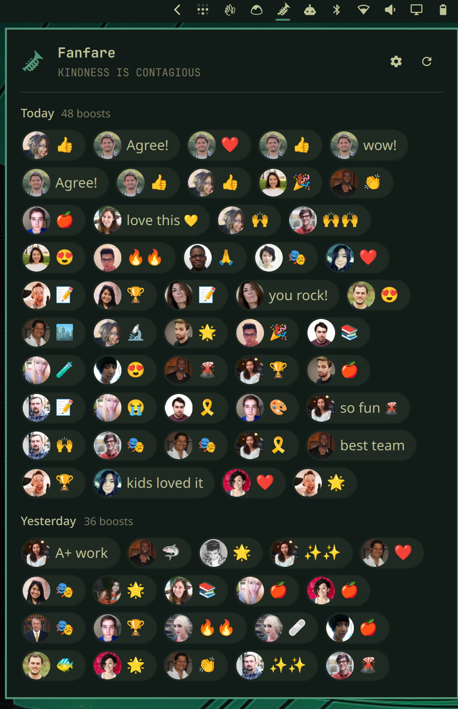

# Fanfare

An Omarchy bar widget that shows the boosts people have given your work in
Basecamp, as a wall of boosts that updates on its own — through the
[Basecamp CLI](https://github.com/basecamp/basecamp-cli).



## Features

- Every boost on your work, newest first, grouped by day and drawn the way
  Basecamp draws them: the booster's avatar and their boost.
- Hover a boost (or arrow to it) to see who it was, when, and what they
  boosted — the comment, answer or chat line it was on, and where that lives.
  Click to open it in Basecamp.
- When new boosts arrive the trumpet turns red and a toast says who; on the
  wall the new ones are ringed until you close the panel — even boosts that
  arrived while your computer was off.
- An optional fanfare sound, off by default and quiet under Do Not Disturb.
- Watches one or many Basecamp accounts.

## Requirements

- Omarchy with shell plugin support.
- The Basecamp CLI, signed in (tested with 0.13):

  ```bash
  omarchy pkg add basecamp-cli
  basecamp auth login
  basecamp accounts list
  ```

Fanfare uses the CLI's existing login. It never reads, copies or stores
Basecamp tokens. If the CLI is missing or signed out, the panel says so and
offers a button that opens a terminal to install it or sign in.

## Installation

```bash
omarchy plugin add https://github.com/robzolkos/fanfare.git --enable
```

Choose a bar section if asked; the manifest puts the trumpet on the right.
Omarchy won't overwrite a plugin that's already installed, so remove an
existing copy first (`omarchy plugin remove rzolkos.fanfare`).

To try a local checkout instead:

```bash
omarchy plugin add ~/path/to/fanfare --enable
```

## Updating and removing

```bash
omarchy plugin update rzolkos.fanfare
omarchy plugin remove rzolkos.fanfare
```

Removing the plugin leaves the Basecamp CLI and its login alone. Fanfare's
saved marks stay in `~/.local/state/fanfare/` until you delete that folder.

## Usage

- Click the trumpet to open or close the wall. Right-click to refresh.
- Hover a boost for its details; click it to open it in Basecamp.
- Keys: arrows move between boosts, Enter opens one, `R` refreshes, `S` opens
  settings, Esc goes back or closes.

## Settings

Open them with the gear (or `S`):

| Setting | Default | What it does |
| --- | --- | --- |
| Accounts to watch | the CLI's default account | Pick any of the accounts your login reaches. |
| Notifications | on | Toast when new boosts arrive. |
| Play a fanfare | off | A short trumpet flourish for new boosts (silent under Do Not Disturb). |
| Check for new boosts every | 5 minutes | How often Fanfare polls (1–60 minutes). |

Settings are saved on the widget's entry in `~/.config/omarchy/shell.json`.

## How it works

Fanfare polls, rather than listening live: Basecamp's event stream reports
boosts across a whole account, not just those on your work, so a poll of your
own boosts is both simpler and cheaper. Each poll reads the newest page of
boosts per watched account and only reads further pages while everything on
a page is new. Basecamp keeps your latest 200 boosts per account.

The text of a boosted comment or answer is fetched once, in the background,
and kept in memory.

To announce boosts that arrive while the shell isn't running, Fanfare keeps,
per account, the time of the newest boost it has announced and the newest
you've seen, in `~/.local/state/fanfare/state.json`. A newly added account
loads quietly rather than announcing its whole history.

## Privacy

Fanfare runs these local commands:

```text
basecamp auth status --json
basecamp accounts list --json
basecamp api get /my/boosts.json?page=<n> --account <id> --json
basecamp api get <boosted item's API URL> --account <id> --jq '{content: .data.content}'
omarchy-notification-send …
pw-play …/sounds/fanfare.ogg   (only with "Play a fanfare" on)
```

Boosts and excerpts are held in the shell's memory only. On disk there are
only your settings in `shell.json` and, in `~/.local/state/fanfare/state.json`,
two timestamps per account — no boost content. Toasts carry the booster's name,
the boost, and what it was on.

## Development

Run the tests — the model in node, the service in Qt's test runner against
a fake CLI:

```bash
./tests/run
```

Restart the shell to load code changes: `omarchy restart shell`.
`omarchy-shell rzolkos.fanfare status` prints the plugin's state, and
`omarchy-shell rzolkos.fanfare testToast 3` toasts the newest boosts.

The fanfare in `sounds/fanfare.ogg` is synthesized for this project with
ffmpeg, so it carries no third-party license.

For testing against a non-production Basecamp, the hidden `cliConfigHome`
setting runs the CLI with `XDG_CONFIG_HOME` set to that directory, so a
separate CLI config (and login) can be used without touching your own. A
development server that builds item links on the wrong host can be corrected
with the hidden `linkRewrite` setting, `{ "from": "<prefix>", "to": "<prefix>" }`.
Links open only over https, or plain http on a `.localhost` host.

## License

MIT
